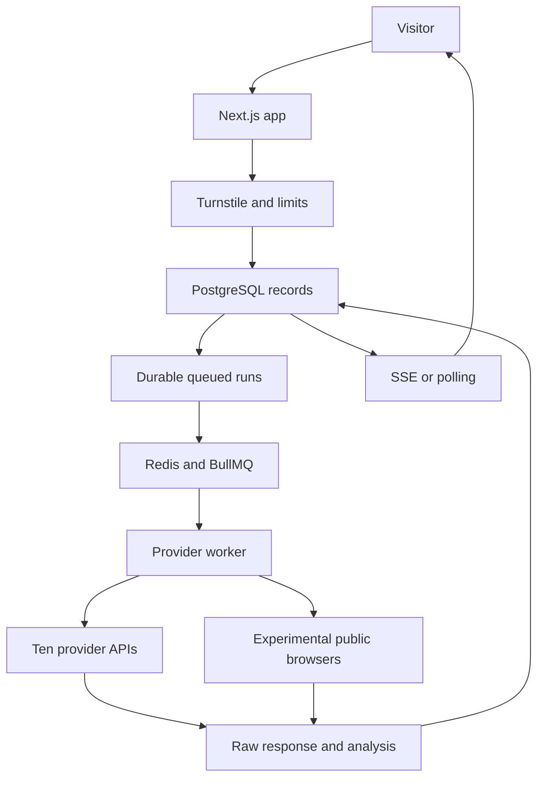

# DoctorFizz LLM Visibility Checker

A Next.js public tool with a separate BullMQ provider worker, PostgreSQL and Redis. The interface uses the rank checker’s shared r12 DoctorFizz visual system, original logos and locally hosted motion assets. There are no fabricated production answers.

## Current state

The app, ten API integrations, queue worker, scoring, limits, Turnstile verification, evidence drawer, CSV export and deployment configuration are implemented. Live calls require the owner's provider accounts, current model IDs and Turnstile keys. No public deployment or real-provider golden-set verification has been performed in this workspace. This is a tested implementation package, not a claim that all upstream accounts are live.

Tier C has experimental public-session Playwright adapters, disabled by default. Its locators are unverified against live UIs and should remain disabled until reviewed. CAPTCHA, login, consent and rate-limit walls stop the attempt; there are no evasion mechanisms.

## Vercel + VPS deployment

Follow [the deployment guide](docs/DEPLOYMENT_VPS_VERCEL.md). The new authenticated API bridge lets Vercel serve the frontend while the VPS retains provider credentials, PostgreSQL, Redis and the persistent worker. See `deploy/vercel.env.example` and `deploy/Caddyfile.split.example`.

## Quick local setup

Requires Node 24, Docker Compose, and provider API accounts for real results.

1. Copy `.env.example` to `.env`.
2. Set a strong PostgreSQL password, a random IP hash salt of at least 32 characters, `APP_URL`, API keys, current model IDs, provider request cost ceilings, and the daily budget. Set the regional `QWEN_API_URL` from your Alibaba account documentation.
3. Configure a Turnstile widget for the exact hostname. Set both keys and `TURNSTILE_HOSTNAME`. The application verifies action `visibility`.
4. Run `docker compose up --build -d`. The migration service waits for PostgreSQL, creates the schema and exits before the web and worker start.
5. Put Caddy in front of port 3000 using `deploy/Caddyfile.example`. Next is exposed only on the host loopback. The proxy must overwrite `X-DoctorFizz-IP`; never trust a visitor-supplied forwarding header. Set `APP_URL` to the final HTTPS origin.
6. Run `docker compose exec worker npm run preflight` and `docker compose exec worker npm run adapters:health`. The health command makes paid sample requests; its reservation is included in the budget.

If a database URL is constructed from the example, use a URL-safe PostgreSQL password. For managed Neon/Supabase, use that provider's connection URL and TLS settings; override the Compose connection mapping accordingly.

For local development with infrastructure running separately:

```bash
npm ci
node --env-file=.env --import tsx src/worker/migrate.ts
npm run dev -- --hostname 127.0.0.1
node --env-file=.env --import tsx src/worker/index.ts
```

Next loads `.env`; the standalone worker commands need the environment loaded explicitly. `DEV_BYPASS_TURNSTILE=true` works only with `NODE_ENV=development`. Keep it false in production. No mock adapter is reachable in the shipped production app; test fixtures stay in tests.

## Architecture



The app never runs Playwright. One queue per provider enforces its global concurrency across worker instances. Database rows form an outbox: reconciliation restores jobs if Redis enqueueing is interrupted. A delayed finalizer and reconciliation enforce the 120-second check deadline. No late provider completion may overwrite a timed-out run.

## Provider registry and API evidence

`src/lib/providers.config.ts` controls provider IDs, credentials, model IDs, search capability, endpoints, cost estimates, concurrency and Tier C flags. `src/lib/provider-adapters/` implements the contract; common REST parsing lives in `src/lib/adapters.ts`.

| Provider   | Interface                           | Search treatment                                                 |
| ---------- | ----------------------------------- | ---------------------------------------------------------------- |
| OpenAI     | Responses                           | `web_search`; reported used only on an observed search call      |
| Claude     | Messages                            | Versioned web-search tool; inspect search result blocks          |
| Gemini     | GenerateContent                     | Google Search grounding; inspect grounding metadata              |
| Perplexity | Sonar Chat Completions              | Native citations/search results; legacy endpoint is configurable |
| Grok       | Responses                           | `web_search`; inspect returned calls                             |
| DeepSeek   | Chat Completions                    | Knowledge only                                                   |
| Mistral    | Conversations                       | `web_search`; inspect tool execution and references              |
| Llama      | Groq Chat Completions               | Knowledge only                                                   |
| Qwen       | Regional OpenAI-compatible endpoint | Knowledge only                                                   |
| Cohere     | v2 Chat                             | Knowledge only; no arbitrary web connector assumed               |

Documentation reviewed for API shapes: [OpenAI](https://developers.openai.com/api/docs/guides/tools-web-search), [Claude](https://platform.claude.com/docs/en/agents-and-tools/tool-use/web-search-tool), [Gemini](https://ai.google.dev/gemini-api/docs/google-search), [Perplexity](https://docs.perplexity.ai/), [xAI](https://docs.x.ai/developers/tools/web-search), [DeepSeek](https://api-docs.deepseek.com/api/create-chat-completion/), [Mistral](https://docs.mistral.ai/studio/agents/agent-tools/websearch), [Groq](https://console.groq.com/docs/openai), [Qwen](https://www.alibabacloud.com/help/en/model-studio/first-api-call-to-qwen), [Cohere](https://docs.cohere.com/reference/chat).

No model ID is hardcoded. Select current IDs supported by your accounts from these official references and run the health command before every production release. API snapshots are not asserted to match personalised consumer apps. A configured search tool can go unused; actual observed search use is displayed separately.

To add a provider, create one adapter implementing `ProviderAdapter`, add its export to the adapter registry, and add its config entry. For the same OpenAI-compatible request/response shape, reuse `runProvider`. Add a parser test for any new shape.

## Safety and abuse controls

- URL fetches accept HTTP/HTTPS only; reject credentials and nonstandard ports; resolve and reject nonpublic IP ranges; pin the validated DNS result to the connection; revalidate every redirect; cap at three redirects, five seconds and one MiB of HTML.
- Site content is quoted untrusted classifier data. Zod validates classifier, prompt and request output. Five prompts must pass length, uniqueness and brand-exclusion validation. Regeneration deactivates previous prompts without deleting retained check evidence.
- Signed HTTP-only visitor cookie plus salted IP hash. A five-check rolling allowance is applied to both visitor and IP, so clearing the cookie does not grant more checks. Shared networks can therefore share an allowance. Independent daily IP and domain caps also apply. Limits use a transaction and advisory lock.
- Turnstile validates action and hostname. Mutation routes check origin and fetch metadata. Per-endpoint Redis rate limits cover public routes.
- Classification and generation reserve a configured upper estimate; provider checks reserve estimates for two attempts and extraction. Budget admission is atomic across these operations. Estimates are not exact provider bills. Set conservative ceilings that cover token and tool fees, and set account-side billing limits as a financial backstop.
- A failed response never means “not found”. Failed runs are excluded. If all fail, allowance is refunded, but the reserved cost and daily abuse counters remain.
- Exact snippets must occur in the answer. Common-word brand names require an additional citation or recommendation signal. Regex fallback labels sentiment neutral.
- Text-only React rendering, safe DOM highlighting and protocol-checked citations prevent answer HTML execution. CSV escapes quotes and spreadsheet formula prefixes.

## Scores, caching and repeat runs

Weights live in `src/lib/scoring.config.ts`; the UI explains them. Successful-run scores are averaged, and unavailable runs have no score. With repeated runs, rows show the run index and “mentioned in k of n successful runs.” The summary counts unique providers separately from runs.

Raw responses are cached for six hours by default using prompt, provider, model, configured search mode and repeat index. Brand analysis is fresh on every check. Cache age is shown. Repeat index prevents one cached response from pretending to be multiple independent repeat samples.

## Development and testing

```bash
npm run typecheck
npm test
npx playwright install chromium
npm run test:e2e
npm run build
```

Unit tests cover aliases, ambiguous names, exact snippets, score denominators, citations, prompt neutrality, blocked IP ranges and API response shapes. PGlite integration tests execute the real SQL schema and check creation, idempotency, allowance, partial completion and refunds. Advisory locking is stubbed in that test harness, so it does not claim to verify real PostgreSQL concurrency. Browser tests use explicitly intercepted transport fixtures for the user flow; they do not claim live provider validation.

The real-provider manual matrix is `docs/golden-brands.csv`. Record exact prompt, provider model, timestamp and result for each brand before launch. Consumer-app comparison is a manual compatibility observation, not a source of API result truth.

## Deployment notes

The web service can run on any Node host with access to PostgreSQL and Redis; the worker runs separately on Docker/VPS. SSE needs a reverse proxy without response buffering. Polling is the fallback. The package includes Node standalone output configuration and an official Playwright worker image. Docker builds were not executed in this workspace; test Compose on the target host.

Provider failures are structured JSON logs. The daily health loop is opt-in with `HEALTH_CHECK_ENABLED=true` because samples can incur API charges. Logs emit a failure alert event; connect your host monitoring to that event. No email or Slack destination is assumed. The six requested interaction events are emitted as structured, anonymous event names through `/api/events`; no brand, URL, contact detail or visitor identifier is included in the event log. Sentry and third-party analytics are optional extension points; environment names are reserved, but this build does not send data to them.

## Repairing an experimental browser adapter

Keep Tier C off by default. Before enabling it, review each provider's terms and verify its public, logged-out interface. Set `TIER_C_ENABLED=true` and `TIER_C_TERMS_REVIEWED=true` only after that review. Locators are in `src/worker/browser.config.ts`; prefer accessible role/name locators. Use internal screenshots from `internal-debug/` to diagnose a wall. Those files must never be served publicly and need a short operational retention policy. Stop on login/CAPTCHA/consent walls. Do not add account sharing, CAPTCHA solving, stealth, fingerprint spoofing or proxies to bypass blocks.

## Assumptions and remaining launch inputs

- English prompts in v1; non-English sites receive a note.
- Dark theme only. The supplied kit has no complete light-theme system.
- The official DoctorFizz and Itzfizz logo PNGs now come from the supplied rank checker. Provider chips use letter identifiers pending an approved provider asset pack.
- Amber with explicit error wording replaces the unspecified error-red token. Secondary neutral text replaces low-contrast muted grey for small text.
- Provider IDs, search syntax, current billing and model support require account-specific live health verification.
- Add the legal controller, privacy contact and jurisdiction to the privacy/terms pages before public launch.
- Lead capture stores consent and contact details; there is no assumed CRM or email integration.
- Result links are bearer links available for seven days. Do not enter confidential data. The deletion action removes browser-associated content, with hashed allowance records retained until expiry.
- Hosted deployment, Docker execution and the real-provider golden set remain unverified until credentials and host access are configured.
