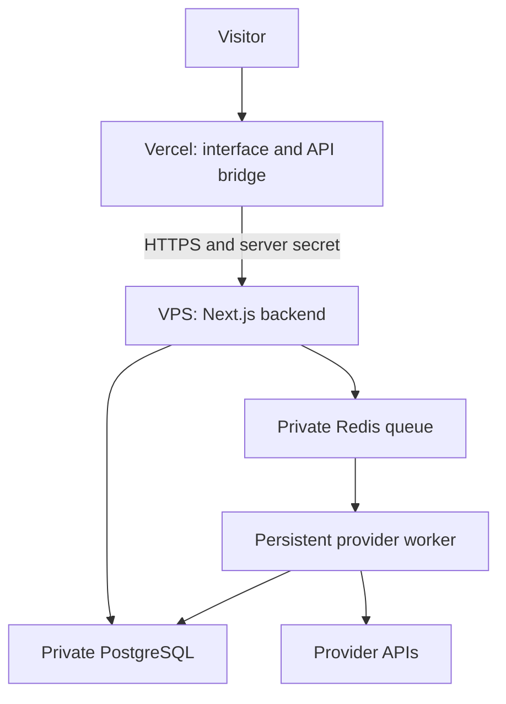

# Run DoctorFizz on Vercel and a VPS

The supplied project supports two deployment modes. Recommended split mode serves the interface and same-origin API bridge on Vercel; a VPS runs the backend web service, persistent worker, PostgreSQL and Redis. Alternatively, deploy the entire project on the VPS and omit Vercel.

The rank checker and LLM checker remain separate tools with a shared DoctorFizz design. This package modifies the LLM project. It includes shared header/footer components and a local copy of the reference's r12 motion assets for reuse in the same product family.

## Split architecture



The browser uses `/api/...` on the Vercel origin. The server bridge forwards cookies, request bodies, CSV downloads and streamed results. The VPS authenticates bridge requests before handling APIs. PostgreSQL and Redis have no public ports. Provider API keys stay on the VPS. Vercel needs a separate bridge secret, not those keys.

## 1. Prepare DNS and the VPS

Use an Ubuntu/Debian VPS capable of running Docker. Start with enough memory for the Node services and database; browser Tier C is disabled by default and requires additional resources if later enabled. Point an A record for `backend.example.com` to your VPS IP. Use `visibility.example.com` as the Vercel frontend domain. Replace these example domains throughout.

Install Docker Engine and the Compose plugin using the official instructions for your OS: https://docs.docker.com/engine/install/ubuntu/. Install Caddy using its official packages: https://caddyserver.com/docs/install. Allow your SSH port and HTTP/HTTPS ports 80/443 in the VPS firewall. Do not open 3000, 5432 or 6379 to the internet.

Upload/unzip this project on the VPS, or push the extracted source to a private Git repository and clone it there. Run commands from the project directory containing `compose.yaml`.

## 2. Configure the VPS

```bash
cp .env.example .env
chmod 600 .env
openssl rand -hex 32
openssl rand -hex 32
openssl rand -hex 24
```

Use the first generated random value for `IP_HASH_SALT`, the second for `BACKEND_SHARED_SECRET`, and the third for `POSTGRES_PASSWORD`. Save them securely. Hexadecimal passwords work in the Compose-created PostgreSQL URL without percent encoding.

Edit `.env`:

```dotenv
APP_URL=https://visibility.example.com
BACKEND_URL=
BACKEND_AUTH_REQUIRED=true
BACKEND_SHARED_SECRET=YOUR_RANDOM_BRIDGE_SECRET
TRUSTED_IP_HEADER=x-doctorfizz-proxy-ip
POSTGRES_PASSWORD=YOUR_RANDOM_DATABASE_PASSWORD
IP_HASH_SALT=YOUR_RANDOM_IP_HASH_SALT
DEV_BYPASS_TURNSTILE=false
TIER_C_ENABLED=false
TIER_C_TERMS_REVIEWED=false
```

Leave `BACKEND_URL` empty on the VPS. Setting it on both hosts creates a relay loop. Compose injects private `DATABASE_URL` and `REDIS_URL` into the web/worker containers, so local URLs in the sample file are overridden there.

For the classifier/extractor, set `OPENAI_API_KEY` and `EXTRACTOR_MODEL` to an available model that supports strict JSON-schema output. For each visibility provider you want to enable, set its API key, model ID, positive request cost ceiling and `*_ENABLED=true`. Disable providers you do not intend to use with `*_ENABLED=false`. Missing credentials/models/cost ceilings disable selection in the public UI. Model IDs must come from your own provider account and current documentation.

Set `DAILY_BUDGET_USD` and `ANALYSIS_COST_CEILING_USD` to your chosen positive budget and conservative per-call ceiling. Each check reserves provider retries and extraction costs; a budget rejection means the next check would exceed the configured allowance, not that a provider has returned a result. Qwen also needs the correct regional/workspace `QWEN_API_URL`.

Create a Cloudflare Turnstile widget allowing your final **frontend** hostname. Configure `TURNSTILE_SITE_KEY`, `TURNSTILE_SECRET_KEY` and `TURNSTILE_HOSTNAME=visibility.example.com`. The server checks the `visibility` action. The VPS backend hostname is not where visitors solve the widget.

## 3. Start the backend and worker

```bash
docker compose up --build -d
docker compose ps
docker compose exec worker npm run preflight
docker compose logs --tail=100 web worker migrate
```

The migration container runs `db/001.sql` after PostgreSQL is healthy. The web service waits for migration completion. The worker must stay running for provider checks and queue reconciliation.

`npm run preflight` checks required settings without printing their values. Fix every missing setting before launch. If only using selected providers, explicitly disable the others. The health check uses the bridge secret internally when backend authentication is enabled.

Copy `deploy/Caddyfile.split.example` to the Caddy configuration and replace `backend.example.com`. Validate and reload it using the official Caddy service instructions, for example:

```bash
sudo caddy validate --config /etc/caddy/Caddyfile
sudo systemctl reload caddy
```

Caddy obtains HTTPS certificates when DNS and ports are correct. A direct unauthenticated visit to `https://backend.example.com/api/health` should return **401**. That is intentional. The frontend bridge supplies the secret.

## 4. Deploy the frontend on Vercel

1. Push the project to a Git repository you own. Keep `.env` and credentials out of Git.
2. Import that repository into Vercel. Choose Next.js and set the project root to the directory containing `package.json`.
3. Select Node.js **24.x**. Use install command `npm ci`, build command `npm run build` and the framework's default output settings. Enable Fluid Compute. Do not run the worker as a Vercel build/start command.
4. Add the production environment variables from `deploy/vercel.env.example`:

| Variable | Value on Vercel |
| --- | --- |
| `APP_URL` | `https://visibility.example.com` |
| `BACKEND_URL` | `https://backend.example.com` |
| `BACKEND_SHARED_SECRET` | Exactly the same bridge secret as the VPS |
| `BACKEND_AUTH_REQUIRED` | `false` |

5. Deploy and attach `visibility.example.com` using Vercel's Domains settings and the DNS records shown there.
6. Keep `APP_URL` identical on both hosts and allow that hostname in Turnstile. Redeploy/restart when environment values change.

The frontend gets public provider availability and the widget's public site key from the authenticated VPS `/api/config` route. Provider changes on the VPS do not require copying keys to Vercel. The frontend must be able to reach the backend over HTTPS during page rendering.

Each App Router API handler exports `maxDuration = 180`, including the streaming bridge. The provider worker applies a 120-second check deadline. Vercel documents the named `maxDuration` export here: https://vercel.com/docs/functions/configuring-functions/duration. Verify your plan and function settings permit 180 seconds. Polling takes over if a streaming connection closes.

The bridge uses Vercel's `x-vercel-forwarded-for` client IP header, replaces user-supplied bridge headers, and passes the IP only to the authenticated backend for hashing. See https://vercel.com/docs/headers/request-headers. Do not place another untrusted proxy in front of this setup or publicly expose the Node port.

For preview deployments, use a separate staging VPS/database or a fixed staging domain with matching `APP_URL` and Turnstile hostname. Arbitrary preview origins are intentionally rejected by production POST origin checks.

## 5. Verify real results

Open `https://visibility.example.com/api/health`: it should return `{"status":"ready"}` through the bridge. Confirm `/api/config` returns only public provider configuration, never keys.

Then:

1. Enter a real public website and brand; inspect the detected category, audience and location.
2. Select one neutral prompt and one configured provider; complete Turnstile and run the check.
3. Confirm the row progresses from queued/running to a final result. Inspect the answer, actual model reported, citations and observed search state in the evidence drawer.
4. Confirm a failed provider is shown as unavailable rather than as score zero, and an all-failed check refunds its allowance.
5. Export the CSV, refresh the saved result URL and verify your visitor cookie still tracks allowance.
6. Run the ten-brand manual matrix in `docs/golden-brands.csv`. Check the displayed analysis against the actual answer text. Provider APIs can differ from their consumer apps; do not promise identical answers.

Optional adapter health requests incur provider charges:

```bash
docker compose exec worker npm run adapters:health
```

Provider keys, VPS access and Vercel account access were not supplied during development, so these live steps and Docker deployment must be run on your target hosts.

## Entire project on the VPS

Use the same Compose setup, leave `BACKEND_URL` empty and set `BACKEND_AUTH_REQUIRED=false`. Set `APP_URL=https://visibility.example.com`, `TRUSTED_IP_HEADER=x-doctorfizz-ip`, and use `deploy/Caddyfile.example`. Its proxy overwrites the trusted IP header. Point the frontend domain to the VPS and configure Turnstile for that domain. Vercel is unnecessary in this mode.

## Updates, backups and common problems

After changing code, run `docker compose up --build -d` on the VPS and redeploy the same revision to Vercel. New environment values require container recreation or frontend redeployment. If you change the bridge secret, update both hosts together.

Back up PostgreSQL with `pg_dump` and preserve the Docker volumes. Do not use `docker compose down -v` unless intentionally deleting all data. Record your secrets outside the repository. Configure VPS monitoring for worker restarts, database health and queue failures.

| Symptom | Check |
| --- | --- |
| Frontend cannot render / backend unavailable | HTTPS/DNS, backend containers, matching bridge secrets, empty VPS `BACKEND_URL` |
| HTTP 401 from the frontend API | VPS and Vercel bridge secrets must match |
| “Origin is not allowed” | Exact frontend `APP_URL` on VPS; use the configured production/staging domain |
| Trusted proxy IP error | Split VPS `TRUSTED_IP_HEADER=x-doctorfizz-proxy-ip`; standalone uses Caddy's `x-doctorfizz-ip` |
| Provider disabled | Key, model, endpoint, enabled flag and positive cost ceiling |
| Invalid verification | Turnstile keys, frontend hostname, action `visibility` and bypass disabled |
| Queued until timeout | Worker running, provider queue connectivity and usable credentials |
| Budget limit reached | Positive budget and ceilings; inspect daily reservations and upstream billing |
| No mention / score zero | Read the original answer: a successful answer can legitimately omit the brand |

Before public launch, add the operator identity and privacy contact to the tool's legal pages. API keys and credentials belong in host environment settings, never in browser code.
